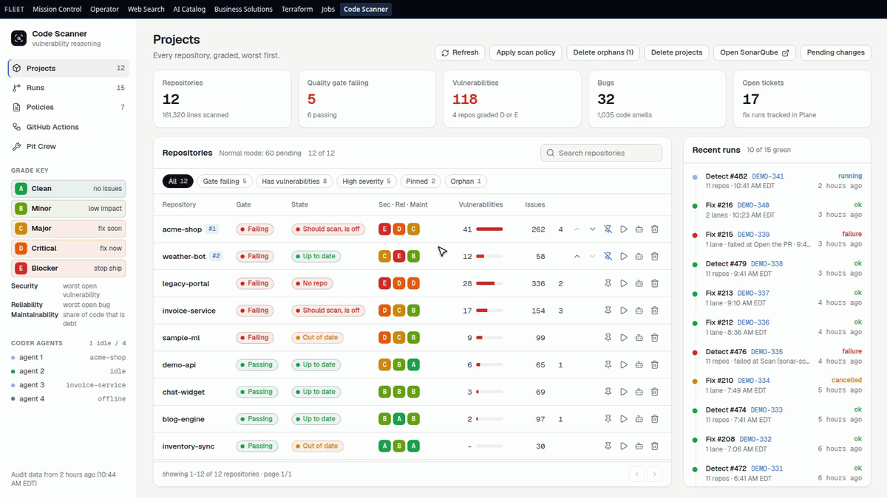
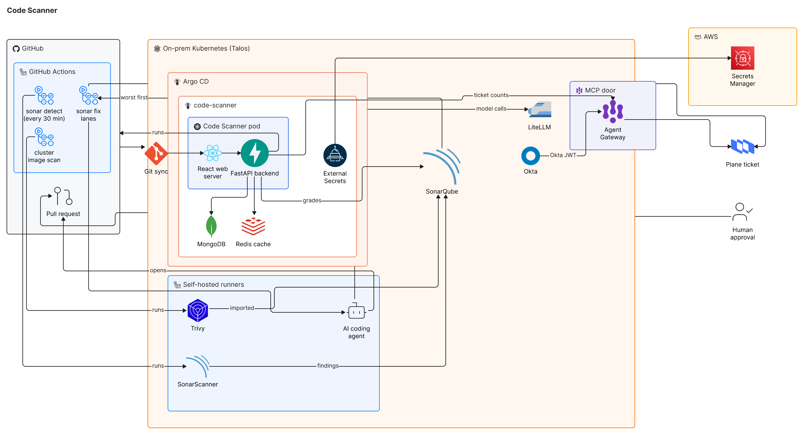

# Sentinel AI

## Executive summary

Sentinel AI is a self-healing code security system with SonarQube at the center: anything that [integrates with SonarQube](https://docs.sonarsource.com/sonarqube-server/latest/analyzing-source-code/importing-external-issues/importing-third-party-issues/) feeds it findings, plain software ranks them worst first, and an AI agent fixes them one rule at a time, either as a pull request a person reviews or on its own through an agent harness acting on your behalf. In both modes the agent works inside hard rules (it cannot hide a problem, weaken a test, or read a password), and every run is written up in plain words on a service ticket: what was found, what changed, and what still needs a person.

- **Projects** grades every project A to E on security, reliability and maintainability, from A (clean) to E (blocker), and search narrows the list. The grades come from  [SonarQube Community Build](https://www.sonarsource.com/products/sonarqube/), which holds every problem from its own scans and from any tool that [integrates with it](https://docs.sonarsource.com/sonarqube-server/latest/analyzing-source-code/importing-external-issues/importing-third-party-issues/) through SARIF or generic issue reports, such as  [Trivy](https://trivy.dev). SonarSource scans and Trivy run on self-hosted runners.
- **Runs** replays a scan and a fix run step by step.  [GitHub Actions](https://docs.github.com/actions) on self-hosted runners turns every finding into one shape (rule, file, line, severity) and orders them worst first. An  [OpenCode](https://opencode.ai) agent with an open-weight model, reached through the  [LiteLLM](https://www.litellm.ai) gateway, reads each finding with its fix guidance, finds the root cause, and changes the code with one commit per rule. By default each fix arrives as a pull request that a person approves or sends back; the same agent can also run autonomously through its [harness](https://opencode.ai/docs/github/), fixing and landing changes on your behalf. Each run writes its summary on a  [Plane](https://plane.so) service ticket, with every number checked against the run's facts.
- **Pit Crew** is a second agentic stack that keeps the first one running. The harness agents fix the code SonarQube flags; the Pit Crew fixes the pipelines those agents and the scans run on. A  [LangGraph](https://langchain-ai.github.io/langgraph/) team of seven agents (Receiver, Analyzer, Researcher, Responder, Fixer, Reviewer, Logger) reads each failed GitHub Actions run, names the failure, and hands a fixable one to a  [Coder](https://coder.com) workspace that pulls the latest code, fixes it with a test and pushes it. A secret, an approval or a ruling goes to a person instead, and the Reviewer checks the next run.

## In action

**Find a project, replay a scan, then open the Pit Crew.** One recording walks the three views above, in that order. (Recorded on demo data.)

## Architecture

Findings flow in from scanners, are ranked by plain software, and are fixed by AI agents that a person can review or let run. A  [React](https://vite.dev) page with a  [FastAPI](https://fastapi.tiangolo.com) backend runs on Kubernetes, deployed by  [Argo CD](https://argo-cd.readthedocs.io).

## License

PolyForm Noncommercial 1.0.0 with a required notice from Haya Tech LLC. Noncommercial use is free; any commercial use, including resale, hosting for others, or a paid product, needs a written license from Haya Tech LLC first. See [LICENSE](LICENSE).
